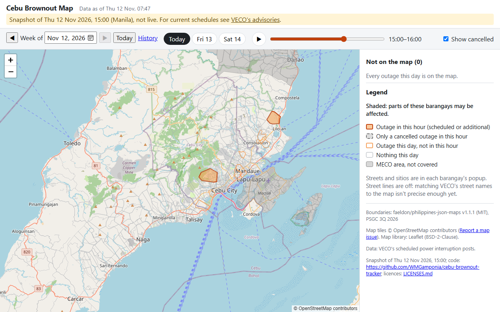
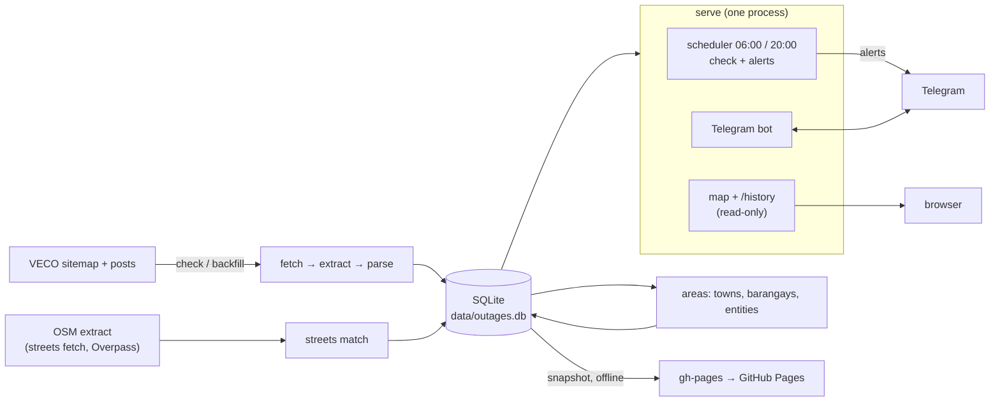
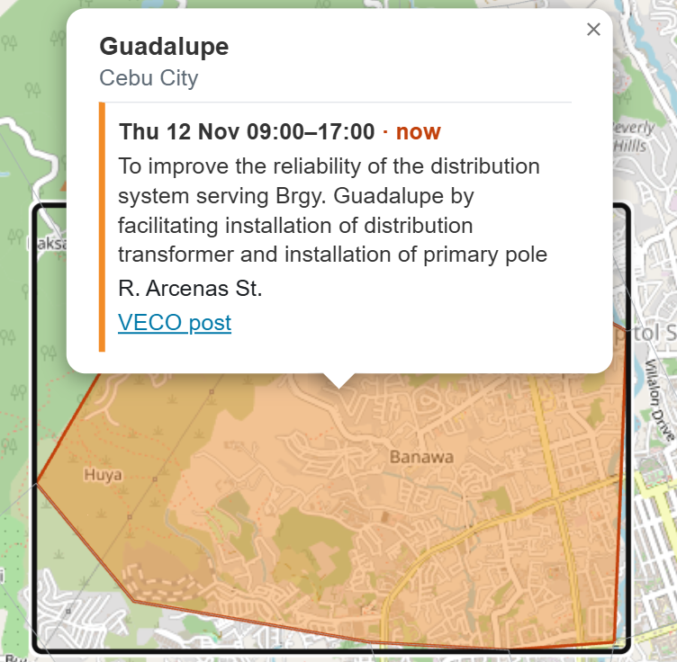
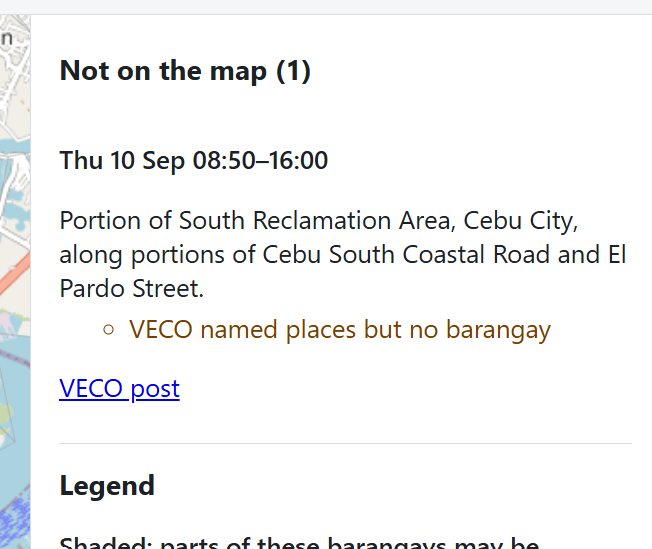
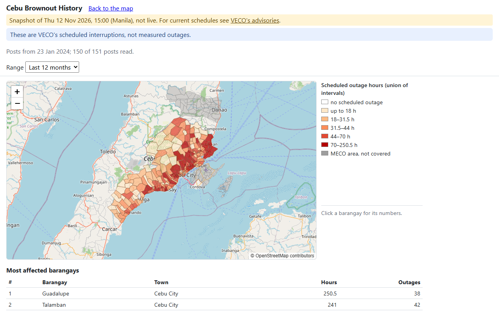

# Cebu Brownout Tracker

Visayan Electric (VECO) announces scheduled power interruptions as blog posts written by hand:
a date, a time, a purpose and a paragraph of places. This project turns those posts into data,
then into per-barangay Telegram alerts, a map you can scrub hour by hour, and a history of where
the power goes out most. It runs on one PC with Python, httpx + selectolax, SQLite, APScheduler,
FastAPI and Leaflet; the small LLM part is measured with evals and lost to plain rules.

**Demo:** [wmgamponia.github.io/cebu-brownout-tracker](https://wmgamponia.github.io/cebu-brownout-tracker/),
a snapshot of 12 Nov 2026, not live. For current schedules see
[VECO's advisories](https://www.visayanelectric.com/).



## What it does

- **Reads VECO's posts:** finds every interruption post from the sitemap (Jan 2024 → now, 151
  posts), fetches politely and keeps every version.
- **Parses them into outages:** start, end, status (scheduled, additional, cancelled), purpose
  and the affected areas, with a change log when VECO edits a post.
- **Places them on barangays:** the area text becomes towns, barangays (PSGC codes), streets,
  sitios and landmarks; what can't be placed is kept with the reason.
- **Alerts on Telegram:** the evening before and the morning of an outage, and on any change,
  to people who subscribed to their barangays.
- **Shows a map and a history:** the week's outages hour by hour, any past week, and outage
  hours per barangay over a range.

## Architecture



| Command | Talks to | Writes |
|---|---|---|
| `check`, `backfill` | VECO | the DB |
| `serve` | VECO, Telegram | the DB |
| `alerts --send`, `bot` | Telegram | the DB |
| `streets fetch --yes` | Overpass (OpenStreetMap) | `data/osm/` |
| `streets suggest` | Ollama on localhost only | `data/streets/` (queue, input log, cache) |
| `map`, `stats`, `report`, `alerts --dry-run`, `snapshot`, `eval`, `streets match`, `areas`, `reparse` | nothing | the DB at most (`map`, `stats`, `snapshot` and dry runs: read-only) |

Tests block the network; offline commands have tests that fail if they build the VECO fetcher,
the Overpass client or a Telegram client.

## Evals, as measured

Every eval fixed its decision rule before the results, on a frozen test split run once.

**Areas (Phase 2): rules vs a local LLM** on 40 hand-labelled area strings
([`evals/areas/results/2026-11-11-test.md`](evals/areas/results/2026-11-11-test.md)). The rule:
Qwen becomes the default only if its street F1 ≥ rules + 5 points and its typed-entity F1 ≥
rules. Claude Haiku was an optional arm, skipped (no API key).

| arm | Street F1 | Street P | Street R | Typed F1 | mean s / string |
|---|---|---|---|---|---|
| rules | 98.9 | 100.0 | 97.8 | 95.3 | 0.00 |
| Qwen 3 14B (Ollama) | 99.4 | 98.9 | 100.0 | 99.4 | 4.69 |

Rules won: Qwen was better by +0.5, not +5. The lesson is in the rule, not the model: with
rules already at 98.9 a +5 margin could never be met, so the outcome was decided before Qwen ran.
Barangays: P/R 100 % on the split (73 of 73), a 98.6 % match rate.

**Streets (Phase 5): draw VECO's street names as lines?** On 50 frozen street mentions with gold
= the OpenStreetMap name ([`evals/streets/p5/results/2026-11-12-test.md`](evals/streets/p5/results/2026-11-12-test.md)),
the bar was precision ≥ 0.95 over ≥ 20 drawn rows, since a wrong line is worse than none.

| drawn | precision | coverage | bar | result |
|---|---|---|---|---|
| 13 | 0.923 (12 of 13) | 0.600 (12 of 20) | ≥ 0.95 over ≥ 20 | **off** |

Two lessons: the split was too small for the bar (only ~40 % of VECO's street names are in OSM,
so ~13 drawn rows was the likely outcome before any rule was written), and two labels used an
OSM `alt_name`, turning right lines into "wrong" ones. Drawing stayed off until a larger split.

**Streets v2: the same bar, 150 fresh mentions.** A new split sampled one mention per
(town, street) at random (seed 20261113), labelled by a fresh labeller from the OSM names in
scope, 25 labels reviewed by the owner, then frozen. The matcher now names a way by its `name`
tag, and owner-approved aliases from an LLM suggester were frozen before the one run
([`evals/streets/results/2026-11-12-test.md`](evals/streets/results/2026-11-12-test.md)):

| drawn | precision | 95 % interval | coverage | matched / alias | bar | result |
|---|---|---|---|---|---|---|
| 68 | 1.000 (68 of 68) | 0.947–1.000 | 0.654 (68 of 104) | 65/65 · 3/3 | ≥ 0.95 over ≥ 20 | **on** |

The point estimate clears the pre-registered bar; the interval's lower end (0.947) is just under
it, so 68 rows can't rule out a true precision a little below 0.95. Four guards ran before the
score: the frozen labels, the frozen rows, the frozen aliases, and a log showing none of the
2,578 mentions sent to the suggester was a test row. The measured precision covers the aliases
frozen on 2026-11-13; aliases approved later are unmeasured.

**The alias suggester.** For each not-found name, the OSM names inside its barangays (+ 150 m)
are ranked by similarity, and Qwen 3 14B (local Ollama) or `difflib` picks one or none. On the
51 dev rows the rules leave not found (7 with an answer, so directional): Qwen 41 of 51 (0.804),
difflib 37 of 51 (0.725), the right name among the 12 candidates in 6 of 7; Qwen fills the
queue. On the full run it picked for 729 of 1,464 groups, some plainly wrong, so nothing is
applied without the owner. The owner decided 14 (13 Qwen picks accepted, 1 other street chosen,
0 rejected); that unlocked 150 more drawn mentions (2,381 → 2,531).

## Screenshots

| | |
|---|---|
|  |  |
| A barangay's popup | "Not on the map", with reasons |



## Setup

```bash
python -m venv .venv
.venv/Scripts/python -m pip install -e ".[dev]"   # Windows; .venv/bin/... elsewhere
python -m pytest -q && ruff check && ruff format --check
node --test "tests/js/*.test.mjs"                 # the pages' time logic; needs Node 22+
python -m outages backfill                        # first run: every post (~151 requests, slow on purpose)
python -m outages areas
```

Node is only for those tests; the app needs no npm packages.

## Commands

`python -m outages <command>`; `--help` lists them all.

| Command | Network | Does |
|---|---|---|
| `backfill` / `check` | VECO | fetch interruption posts (polite: sitemap, one request at a time) |
| `reparse`, `report`, `areas` | none | re-parse stored posts, print the report, parse area texts |
| `alerts --dry-run` | none | print what an alert run would send now; read-only |
| `alerts --send` | Telegram | one alert run on stored data (no VECO fetch) |
| `bot` | Telegram | the subscription bot, until Ctrl+C |
| `map [--host] [--port]` | none (listens only) | the outage map at http://127.0.0.1:8765 and `/history`; read-only |
| `stats [--from] [--to]` | none | history stats for a date range (default: the last 365 days); read-only |
| `snapshot --out <dir> [--allow-old]` | none | the static demo for GitHub Pages; read-only |
| `streets fetch [--yes] [--towns]` | **Overpass** | download the OpenStreetMap street extract, one request per town; without `--yes` it only prints the requests |
| `streets match [--rebuild] [--dry-run]` | none | match VECO's street names to the extract |
| `streets --review` | none | street names not found, with close OSM names to consider as aliases |
| `streets suggest [--limit N]` | localhost Ollama | queue alias suggestions for not-found street names in `data/streets/alias_queue.csv` |
| `streets suggest --apply` | none | apply the queue's decisions to `street_aliases.csv` (with provenance) or the rejects file |
| `streets candidates --rows <file>` | none | the OSM names in scope for each row (labelling helper) |
| `eval sample\|run\|check\|review-sample\|freeze [--suite areas\|streets\|streets-v2\|streets-suggest]`, `eval freeze-aliases` | none | the labelled evals; the street test run checks four guards first |
| `serve` | VECO + Telegram (+ localhost Ollama) | check + alerts at 06:00 and 20:00 Manila, catch-up on start, bot and map threads (`--no-map`, `--map-host`, `--map-port`), then up to 20 new street suggestions (`--no-suggest`) |

`serve`, `bot`, `check`, `backfill` and `alerts --send` take a lock (`data/serve.lock`): a second
one exits 3 with "serve is already running (pid N); stop it first". Read-only commands never
take it.

## Telegram alerts

1. In Telegram, message **@BotFather**, send `/newbot`, and copy the token it gives you.
2. Create `.env` in the project root (git ignores it; never commit or paste it):
   ```
   TELEGRAM_BOT_TOKEN=<token from BotFather>
   TELEGRAM_ALLOWED_CHAT_IDS=
   TELEGRAM_ADMIN_CHAT_ID=
   ```
3. Run `python -m outages bot` and send your bot `/start`. Without an admin chat it answers
   "Not taking new requests right now" and logs `bot: join request from chat <id> refused`.
4. Put that ID in both keys (`TELEGRAM_ALLOWED_CHAT_IDS` takes several, comma-separated), restart
   the bot, send `/start` and `/add <your barangay>` (a name in several towns gives buttons).
   `/list` and `/remove` manage subscriptions.
5. `python -m outages alerts --dry-run` shows what would be sent; `serve` sends it on schedule.

Alerts go out the evening before (~20:00) and the morning of (~06:00) an outage, and when VECO
adds, cancels, re-times, re-scopes or removes one. A row whose barangay VECO lists under the wrong
town never alerts anyone; the admin chat gets a note instead. The token never appears in logs.

### Letting other people join

Anyone can send `/start`. They become **pending**: the welcome says the bot runs on one person's
computer (alerts can be late or missed) and what it stores, and the admin chat gets
**Approve** / **Deny** buttons. Approved people use `/add`, `/list`, `/remove`; denied chats are
ignored from then on. Chats in `TELEGRAM_ALLOWED_CHAT_IDS` never need approval.

- **Admin chat only:** `/pending`, `/users` (first name, status, number of barangays, chat ID;
  never the barangays), `/revoke <chat id>` (drops their data and blocks the chat).
- **Everyone:** `/privacy` says what is stored (chat ID, first name, barangays, which alerts were
  sent) and why; `/forget` deletes all of it.
- **Limits:** private chats only; at most 20 pending requests and 10 barangays per person; more
  than 20 messages a minute mutes a chat for 10 minutes; alerts at least 50 ms apart.

## The map

`serve` also serves the map at **http://127.0.0.1:8765** (or `python -m outages map` alone). Pick
a day and an hour, or press ▶, and see which barangays **may** be without power then. Click a
barangay for the time, purpose, streets and VECO's post. Times are Manila time whatever your
computer's zone.

- **"May be affected":** VECO writes "portion of" on nearly every line, so a whole barangay is
  shaded; the places in the popup say which part.
- **Never hidden:** an outage the map can't place is listed under **Not on the map** with the
  reason. Cancelled outages are greyed (toggle "Show cancelled"); removed ones are counted.
- **Honest about age:** "Data as of …" is the last check; a warning shows past 15 h (a missed
  run), and outages from a post we couldn't re-read carry a caveat.
- **Other weeks:** **Week of** (◀ ▶, a date, **Today**), or `?from=2026-10-01&days=7` (≤ 14 days).
- **History:** `/history` shows scheduled outage hours per barangay for a range (default: the
  last 12 months), the 10 most-affected barangays, durations, towns, months, and what was left
  out. These are VECO's *scheduled* interruptions, not measured outages. `stats` prints the same.
- **Read-only:** the map never writes the DB and never contacts VECO or Telegram (the local
  street review page writes only `data/streets/alias_queue.csv`). If it can't
  start, `serve` logs it, tells the admin chat once a day, and keeps running the alerts.
- **Your LAN:** `--host 0.0.0.0` makes it reachable from other devices. There is no login; it
  logs a warning, and the street review page is not served then.

## Streets

VECO names streets ("along portions of Gorordo Ave."). The map draws them from a local
OpenStreetMap extract, clipped to each outage's own barangays + 150 m, because the street eval
passed its bar (above): `STREETS_DRAW` in `config.py` is on. Cancelled outages draw grey dashed;
"Show streets" hides them.

1. `python -m outages streets fetch` prints the 8 Overpass requests (one per VECO town, 10 s
   apart); `--yes` makes them. Files go to `data/osm/`; `--towns "Cebu City"` refetches one.
2. `python -m outages streets match --dry-run` counts; without `--dry-run` it writes
   `street_matches` (back up `data/outages.db` first). `check` and `reparse` keep it current.
3. **Aliases for names OSM spells differently:** `python -m outages streets suggest` queues a
   suggestion per not-found (town, name) group; `serve` adds up to 20 new groups after each run
   and tells the admin chat when some are waiting. Decide them at
   **http://127.0.0.1:8765/streets/review** (only on a loopback bind): the map shows the named
   barangays, the suggestion in bold and the other streets nearby; **Yes / No / Skip** (`y` /
   `n` / `s`) or click another street. Or fill the CSV's `decision` column. Then
   `streets suggest --apply` and `streets match --rebuild`. Nothing is applied automatically, and
   a rejected name is never suggested again.

The extract is OpenStreetMap data under the [ODbL](https://opendatacommons.org/licenses/odbl/):
it stays in `data/` (never committed).

## Running at login (Windows)

`serve` runs the checks, alerts, bot and map; it should start when you log in and survive sleep.

```powershell
powershell -NoProfile -ExecutionPolicy Bypass -File scripts\install-task.ps1 -WhatIf   # see what it would register
powershell -NoProfile -ExecutionPolicy Bypass -File scripts\install-task.ps1           # install (as administrator if it says so)
powershell -NoProfile -ExecutionPolicy Bypass -File scripts\install-task.ps1 -Uninstall
```

- **"OutageTracker serve"** starts `.venv\Scripts\pythonw.exe -m outages serve` at logon (no
  console; the log is `data\logs\outages.log`), restarts it up to 3 times a minute apart, and
  never starts a second copy.
- **"OutageTracker wake"** wakes the PC at 05:58 and 19:58 and keeps it awake for 15 minutes
  for the 06:00 / 20:00 runs (`serve` also keeps it awake until each run ends). Turn on
  **Allow wake timers** in your power plan (Control Panel → Power Options → advanced settings →
  Sleep). `-NoWake` skips it (a laptop asleep in a bag won't wake anyway).
- A `serve` started in a terminal while the task runs exits 3: the lock allows one.

**After an update:** `git pull` → `.venv\Scripts\pip install -e .` →
`Stop-ScheduledTask "OutageTracker serve"` → `Start-ScheduledTask "OutageTracker serve"`. Stopping
mid-run is safe for the DB; at worst one alert is sent twice.

**"Data more than 15 h old" on the map:** check the task's *Last Run Result* in Task Scheduler,
the tail of `data\logs\outages.log`, and whether the PC slept past a run. `serve` looks every
5 minutes: a run slept through is done within minutes of waking (logged as `missed the 06:00
run`), once per run time even if VECO is unreachable then.

## Publishing the snapshot

The demo is a static copy of the map and `/history` on GitHub Pages, refreshed by hand. It lives
on the `gh-pages` branch, checked out as a worktree at `site/` (git-ignored on `main`):

```bash
git worktree add site gh-pages                      # once per clone
python -m outages check                             # if the data is more than 15 h old
python -m outages snapshot --out site               # offline, read-only
git -C site status --short | head
python -m http.server -d site -b 127.0.0.1 8766     # have a look first
git -C site add -A && git -C site commit -m "snapshot: <taken_at>" && git -C site push
```

`snapshot` writes the snapshot week plus 52 weeks back, the history ranges (last 12 months, each
year from 2024, this year to date), `snapshot.json` and `LICENSES.md`. Time is pinned to the
moment it ran. It refuses data more than 15 h old (`--allow-old` for a local look only), a folder
holding anything but a previous snapshot, and output containing a chat ID or the bot token; it
can't read the subscriber or alert tables at all. Every week file changes on each refresh
(`meta.generated_at`), so review `snapshot.json`, the printed summary and the pages rather than
the diff size.

## Licences

The code is [MIT](LICENSE). Everything else keeps its own terms:

- **Outage data** comes from VECO's public advisories, each outage linked to its post; only
  parsed fields are published, not the posts. Not affiliated with VECO. The test fixtures are
  trimmed excerpts of real posts, kept for the parser tests.
- **Barangay boundaries:** [faeldon/philippines-json-maps](https://github.com/faeldon/philippines-json-maps)
  v1.1.1 (MIT), PSGC 3Q 2026.
- **[Leaflet](https://leafletjs.com) 1.9.4** (BSD-2-Clause), vendored.
- **Map tiles** © [OpenStreetMap](https://www.openstreetmap.org/copyright) contributors, under the
  OSMF tile usage policy; your browser fetches them from OpenStreetMap.
- **Street lines** are derived from OpenStreetMap data, © OpenStreetMap contributors, under the
  [ODbL](https://opendatacommons.org/licenses/odbl/); in the snapshot they are in
  `weeks/*.geojson` (`streets.drawn[].lines`), and `LICENSES.md` names the extract's date.

How it was built, phase by phase, with every decision and what went wrong:
[`ROADMAP.md`](ROADMAP.md); designs in [`docs/superpowers/specs/`](docs/superpowers/specs/).
